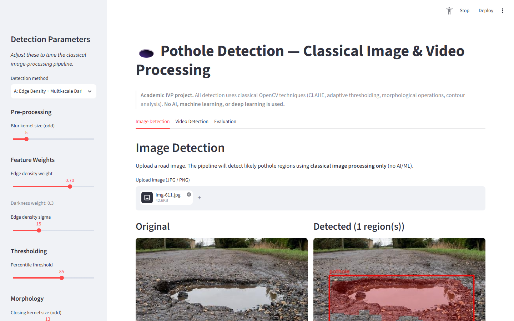
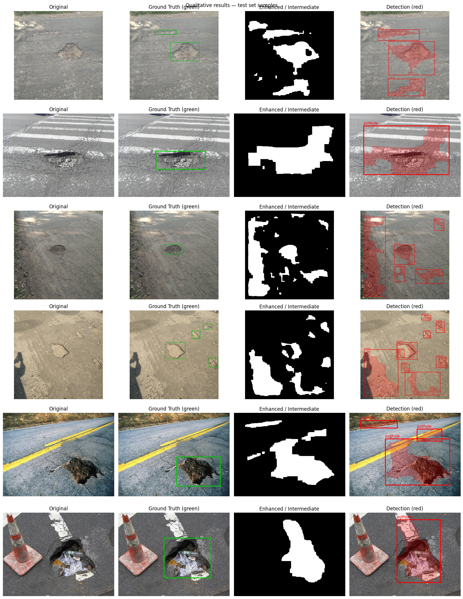

<div align="center">

# 🕳️ CraterScope 2.0

### Pothole Detection with a Classical Gate and Neural Detectors

**Research release: a reproducible comparison of classical proposals, a learned gate, road-strip masking, and YOLO11n.**



Version 2 is the current research implementation in this repository. It supersedes the original classical-only prototype for the experiments described here. Version 3 is still research planning; it has not been published as a release.

</div>

---

## Overview

CraterScope 2.0 evaluates whether a fast classical road-scene stage can reduce the cost of pothole detection without sacrificing accuracy. The code includes a classical proposal pipeline, a learned presence gate, a MobileNetV3 crop verifier, YOLO11n reference and hybrid paths, frozen dataset splits, evaluation scripts, and a Streamlit interface.

The final results do **not** support the original claim that a hybrid cascade beats both standalone approaches. The gate did not work reliably, and the full hybrid missed its latency target. The clean positive result is narrower: the road strip removes 40% of the input with no measurable accuracy loss. The measured YOLO11n reference is strong in precision but has low recall.

| Version | Status | What it contains |
|---|---|---|
| [Version 1](../README.md) | Published in the repository root | Classical image and video processing prototype |
| **Version 2** | Current research release | Reproducible experiments, classical gate, learned models, and measured results |
| Version 3 | Not published | Research directions and assessment are recorded below; no v3 implementation is included |

## Results

### Roadmap targets

| Target | Result | Status |
|---|---:|---|
| H1: P ≥ 0.50 with R ≥ 0.110 | P 0, R 0 | ❌ Not met. The classical proposals miss nearly every pothole. |
| YOLO11n reference: P ≥ 0.70 | P 0.887; R 0.104 | ✅ Precision target met; recall is just below the 0.110 baseline. |
| Method A ≤ 40 ms/image | 41.7 ms | ≈ Essentially met. |
| Full hybrid ≤ 50 ms/image | 62.5 ms | ❌ Not met. |
| Video ≥ 15 FPS at 720p (H3) | Not measured | Rerun with `--only 7 9 10 --clips clips`. |

Metrics are from the version 2 evaluation on the frozen test split. Thresholds were selected on validation. The YOLO11n number is a reference result, not evidence that the hybrid gate improves it.

### Earlier CraterScope model

The images below are existing version 1 artifacts from this repository, included to show the original app and model without rerunning inference. They are historical examples and are **not version 2 model outputs**.

| Original app | Original model test examples |
|---|---|
|  |  |

### What the results support

- The test split was run. Version 2 reports the measured test results rather than claiming evaluation is pending.
- Metrics and comparisons use the same detector and split, with thresholds frozen on validation and significance tests. This replaces the earlier invalid mAP and mismatched classical-versus-AI comparison.
- The road strip removes 40% of the input with no measurable accuracy loss.
- The main hybrid claim is not supported: the gate did not work as intended, and the complete hybrid takes 62.5 ms per image against a 50 ms target.

### Limitations

- The story is less positive than the original proposal: the gate fails, lower resolution beats a learned gate, and a fixed crop helps. Much of the result is a negative finding.
- The positive road-strip result is modest; road cropping is established practice, and its speed-up is still a projection rather than a timed rectangular road-strip model result.
- A test mAP@0.5 of 0.39 from one YOLO11n run is ordinary and does not establish broad performance.
- The paper is 8 pages, down from 11, after removing theory and proposals unsupported by the data.

## Version 3 research assessment

**Yes as a piece of research; no as a headline result.** The corrected version 2 evidence is more defensible, but the contribution is limited. It could fit a workshop or mid-tier conference; a strong venue could reject it for limited novelty and reliance on one model.

The next experiments with the highest expected value are:

1. **Time a rectangular road-strip model.** This would turn the current projected speed-up into a measured primary result.
2. **Repeat across three or four lightweight architectures.** Train them under the same protocol with multiple seeds to check whether the conclusions hold beyond YOLO11n.
3. **Test a purpose-built cheap gate at lower pothole prevalence.** The cost model predicts gating should become useful there. If the measurements support that prediction, the contribution could be a practical rule for when gating is worthwhile.

All three additions need a GPU route, which remains the blocker. These are proposed research steps, not version 3 results.

## Quick start

Run commands from this directory (`v2/`). Python 3.11 or 3.12 is recommended.

```powershell
py -3.11 -m venv .venv
Set-ExecutionPolicy -Scope Process -ExecutionPolicy Bypass
.\.venv\Scripts\Activate.ps1
python -m pip install --upgrade pip
pip install -r requirements.txt
python config.py
python smoke_test.py
```

The smoke test uses synthetic images. Dataset evaluation and trained-model inference require the corresponding dataset and model files, which are not bundled in this source release. For GPU training, follow [`colab_train.ipynb`](colab_train.ipynb) and [`Training and data instructions`](#training-and-data).

### Training and data

The workflow supports RDD2022 and optional HRP4K data preparation, a frozen grouped split in `splits.json`, Colab training, model export, validation threshold tuning, and a final test evaluation. Data downloads and generated model files are intentionally kept outside the source package.

- **RDD2022:** the project downloads the official [Figshare release](https://doi.org/10.6084/m9.figshare.21431547). Start with India using the commands below, or pass `--countries all` to include the other supported countries.
- **HRP4K (optional):** the preparation script accepts the dataset from its [Zenodo record](https://zenodo.org/records/17522874). It is optional training data.
- **Split:** `splits.json` records the frozen grouped split. Preserve it for comparable experiments; do not regenerate the split when reproducing the reported evaluation.

```bash
python get_rdd2022.py --countries India
python prep_rdd2022.py --src downloads/rdd2022 --countries India
python prep_split.py --raw datasets/raw --eval-sources rdd_india
python fit_gate.py --row 7
python train_yolo.py --model yolo11n.pt --epochs 100 --batch 32
python evaluate.py --row 9 --split val --tune
python evaluate.py --row 9 --split test
```

See [`colab_train.ipynb`](colab_train.ipynb) for the complete GPU workflow. Evaluation thresholds must be tuned on validation, then held fixed for test reporting. The final video target still needs a clip set and can be measured with `python finish_goal1.py --only 7 9 10 --clips clips`.

## Project structure

```text
├── app.py                 Streamlit image and video interface
├── classical.py           Classical proposal and road-mask pipeline
├── gate.py, fit_gate.py   Presence gate and fitting procedure
├── detector.py            MobileNetV3 crop verifier
├── ai_detector.py         YOLO11n reference and ONNX paths
├── cascade.py             Image and video cascade
├── config.py              Ablation rows and shared settings
├── evaluate.py             Metrics, latency, tuning, comparisons
├── finish_goal1.py         Reproducible end-to-end evaluation workflow
├── prep_split.py           Frozen grouped split generation
├── train_*.py              Training entry points
├── colab_train.ipynb       GPU training workflow
├── splits.json             Frozen split definition
└── results/                Compact evaluation outputs and report
```

## License and data

The code follows the repository's [MIT License](../LICENSE). Datasets remain subject to their original licenses and are not included. Model checkpoints are generated or obtained separately and are not bundled here.
